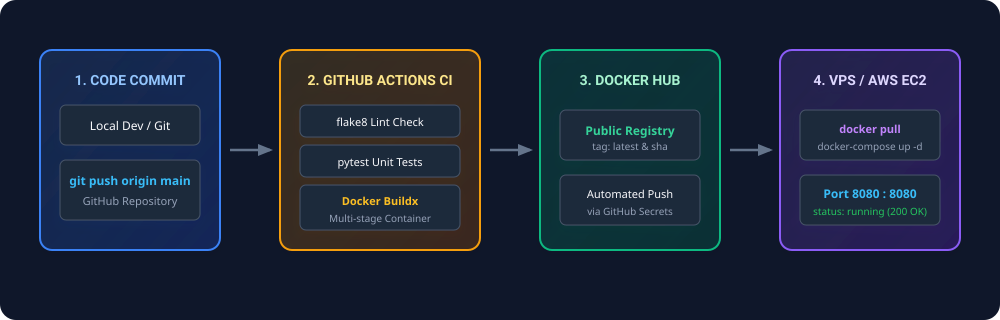
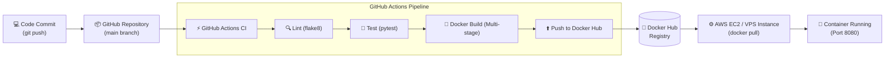

# DevOps Candidate Screening Task — Care Guide

[](https://github.com/SouravDasHriday/care-guide-devops-task/actions)


This repository contains the complete implementation of the **DevOps Screening Task for Care Guide**. It features a containerized Python web application, a multi-stage Docker build, GitHub Actions automated CI pipeline, a Linux server health monitoring script, and deployment strategies for AWS/VPS environments.

---

## 📌 Architecture & End-to-End Workflow

The diagram below illustrates the end-to-end continuous integration and deployment flow:



### Workflow Breakdown



1. **Code Commit:** Developer commits code changes and pushes to the `main` branch.
2. **GitHub Actions CI:** Triggered automatically to lint Python code (`flake8`), run automated unit tests (`pytest`), and validate shell scripts.
3. **Docker Build & Push:** Docker Buildx builds the multi-stage image and pushes tagged releases (`latest` and `sha-<commit>`) to Docker Hub.
4. **VPS / EC2 Deployment:** The host pulls the verified container from Docker Hub and runs it with Docker Compose on port `8080`.

---

## 📁 Repository Structure

```text
.
├── .github/
│   └── workflows/
│       └── ci.yml                 # Automated CI workflow (lint, test, build, push)
├── app/
│   ├── __init__.py
│   └── main.py                    # Minimal Flask API (root & health endpoints)
├── docs/
│   └── architecture-workflow.svg  # Visual architecture diagram asset
├── scripts/
│   └── system_health.sh           # Linux metric monitor & threshold alert script
├── tests/
│   └── test_main.py               # Automated endpoint verification tests
├── .dockerignore                  # Docker context exclusion rules
├── .flake8                        # Flake8 style & PEP 8 lint configuration
├── .gitignore                     # Git tracking exclusions
├── Dockerfile                     # Production multi-stage Docker build
├── docker-compose.yml             # Local / VPS container orchestration
├── pytest.ini                     # Pytest runner settings
├── requirements.txt               # Production dependencies (Flask, Gunicorn)
├── requirements-dev.txt           # CI/Dev dependencies (pytest, flake8)
└── README.md                      # Comprehensive project documentation
```

---

## 🚀 Step 1: Web Application & Containerization

### Application Overview
The web application is implemented in Python using **Flask** and served via the **Gunicorn** WSGI production server:
- **`GET /`** returns HTTP 200 with the required JSON payload:
  ```json
  {
    "message": "Hello from DevOps Intern Task!",
    "status": "running"
  }
  ```
- **`GET /health`** returns HTTP 200 `{"status": "healthy"}` for container health probes.

### Docker Best Practices Implemented
- **Multi-Stage Build:** Dependencies are compiled in an isolated `builder` stage (`python:3.11-slim`), and only runtime artifacts are copied to the minimal `runner` image.
- **Lightweight Base Image:** Uses Debian-based `python:3.11-slim` rather than full Ubuntu/Python images, minimizing image size and attack surface.
- **Non-Root Execution:** A dedicated unprivileged system user (`appuser`, UID 1001) runs the container, mitigating container escape vulnerabilities.
- **Proper Layer Caching:** `requirements.txt` is copied and installed prior to copying source code, ensuring fast incremental builds.
- **Container Health Check:** Built-in `HEALTHCHECK` periodically verifies service availability via `curl`.
- **Production WSGI Server:** Runs multi-threaded Gunicorn instead of Flask's built-in development server.

### Running with Docker Compose

1. **Clone the repository:**
   ```bash
   git clone https://github.com/SouravDasHriday/care-guide-devops-task.git
   cd care-guide-devops-task
   ```

2. **Start the application in detached mode:**
   ```bash
   docker compose up -d --build
   ```

3. **Verify container status:**
   ```bash
   docker compose ps
   ```

4. **Test the endpoint:**
   ```bash
   curl -i http://localhost:8080/
   ```
   **Expected Response:**
   ```http
   HTTP/1.1 200 OK
   Content-Type: application/json
   Content-Length: 68

   {
     "message": "Hello from DevOps Intern Task!",
     "status": "running"
   }
   ```

5. **Stop the application:**
   ```bash
   docker compose down
   ```

---

## 🔄 Step 2: CI Pipeline (GitHub Actions)

The workflow is defined in [`.github/workflows/ci.yml`](.github/workflows/ci.yml) and automatically triggers on:
- Every `push` to the `main` branch.
- Every `pull_request` targeting `main`.
- Manual trigger via `workflow_dispatch`.

### CI Pipeline Stages

| Stage | Tool | Description |
| :--- | :--- | :--- |
| **Linting** | `flake8` | Enforces PEP 8 standards and checks for syntax errors / unused imports. |
| **Testing** | `pytest` | Runs unit tests against API endpoints to guarantee response contracts. |
| **Script Validation** | `bash -n` | Checks shell script syntax without execution. |
| **Container Build** | `docker/buildx` | Builds multi-stage Docker image and verifies Dockerfile buildability. |
| **Container Publish** | `docker/login-action` | Pushes tagged images (`latest` and commit SHA) to Docker Hub when credentials are provided. |

### Docker Hub Credentials Setup
To enable automated push to your Docker Hub repository:
1. In your GitHub repository, go to **Settings** > **Secrets and variables** > **Actions**.
2. Add the following repository secrets:
   - `DOCKERHUB_USERNAME`: Your Docker Hub username.
   - `DOCKERHUB_TOKEN`: Docker Hub Personal Access Token (PAT).

*(Note: If secrets are omitted, the workflow gracefully builds and validates the Docker image without pushing).*

---

## 📊 Step 3: Linux Automation Scripting

The script [`scripts/system_health.sh`](scripts/system_health.sh) is a standalone Bash utility that monitors system resources and appends timestamped logs to `health_log.txt`.

### Key Features
- **CPU Usage:** Retrieves current CPU load percentage.
- **Memory Usage:** Calculates active/used memory percentage and megabytes.
- **Disk Usage:** Inspects root mount (`/`) disk usage percentage.
- **Alert Logic:** If disk usage exceeds **80%**, prints `[WARNING] Disk space high!` to stdout and records the incident in the log.
- **Cross-Platform:** Compatible with Linux (Ubuntu, Amazon Linux 2 / 2023 on AWS EC2) and macOS.

### Executing the Script

1. **Make the script executable:**
   ```bash
   chmod +x scripts/system_health.sh
   ```

2. **Run the script:**
   ```bash
   ./scripts/system_health.sh
   ```

3. **Sample Terminal Output:**
   ```text
   Logged: [2026-10-16 05:52:11] CPU Usage: 5.2% | Memory Usage: 42.1% (1684MB/4000MB) | Disk Usage: 34%
   ```

4. **Verify the generated log file:**
   ```bash
   cat health_log.txt
   ```

5. **Test the threshold warning logic (simulation):**
   ```bash
   # Set a custom threshold lower than current disk usage (e.g., 10%)
   DISK_THRESHOLD=10 ./scripts/system_health.sh
   ```
   **Output:**
   ```text
   Logged: [2026-10-16 05:52:49] CPU Usage: 3.4% | Memory Usage: 42.0% (1680MB/4000MB) | Disk Usage: 34%
   [WARNING] Disk space high!
   ```

---

## ☁️ Step 4: AWS Cloud Deployment Strategy

### *"How would you deploy this container to AWS (e.g., EC2 or any other VPS)?"*

Here is the structured 3-phase deployment approach:

1. **EC2 Provisioning & Container Runtime (Baseline Deployment):**
   - Launch an Amazon EC2 instance (e.g., `t3.micro` or `t3.small` running Amazon Linux 2023 or Ubuntu 24.04 LTS).
   - Attach an AWS Security Group permitting inbound traffic on port `22` (restricted SSH access) and port `8080` (HTTP web traffic).
   - Install the Docker runtime and Docker Compose plugin via user-data script or package manager (`dnf install docker` / `apt install docker.io docker-compose-plugin`).
   - Clone the repository (or pull the prebuilt image from Docker Hub) and execute `docker compose up -d`.

2. **Automated Continuous Deployment (CI/CD to VPS):**
   - Add a Deployment job to `.github/workflows/ci.yml` following the `build-and-push` stage.
   - Use secure SSH deployment (via GitHub Secrets holding `EC2_HOST` and `EC2_SSH_KEY`) or AWS Systems Manager (SSM) Run Command to execute:
     ```bash
     docker pull <username>/care-guide-devops-task:latest
     docker compose up -d --remove-orphans
     ```
   - This ensures zero manual intervention whenever code merges into `main`.

3. **Enterprise Production Architecture (Scalability & High Availability):**
   - Transition container workloads from raw EC2 to **AWS ECS (Elastic Container Service) with AWS Fargate** (serverless containers) to eliminate OS-level maintenance.
   - Place tasks behind an **Application Load Balancer (ALB)** with an AWS ACM SSL/TLS certificate for HTTPS on port `443` mapping to container port `8080`.
   - Implement **Auto Scaling Policies** (target CPU/memory at 70%) and stream logs directly into **Amazon CloudWatch** with metric alarms notifying through Amazon SNS.

---

## 🧪 Local Testing & Verification Checklist

Before pushing to GitHub or deploying to EC2:

```bash
# 1. Run Linter
flake8 app/ tests/

# 2. Run Unit Tests
pytest -v

# 3. Test Shell Script
./scripts/system_health.sh

# 4. Build and Run Container
docker compose up -d --build

# 5. Query Container
curl -i http://localhost:8080/
```

---

## 👨‍💻 Candidate Interview Quick Reference

| Topic | Key Talking Points |
| :--- | :--- |
| **Why Multi-Stage Docker?** | Isolates build tools/compilers from runtime, dramatically reducing final image size and removing unnecessary attack vectors. |
| **Why Non-Root User?** | If an attacker exploits a vulnerability inside the container, non-root privileges prevent them from gaining root access to the host kernel. |
| **Why Gunicorn over Flask dev server?** | Flask's built-in server is single-threaded and not hardened for production concurrency; Gunicorn provides worker management and connection pooling. |
| **How does healthcheck work?** | Docker periodically issues an HTTP GET to `/health`. If non-200 responses occur across retries, container status switches to `unhealthy`, enabling orchestrators to restart it. |
| **Script Design:** | Uses POSIX-standard commands (`top`, `df`, `awk`), modular functions, timestamped appending, and threshold evaluation with clean exit codes. |
